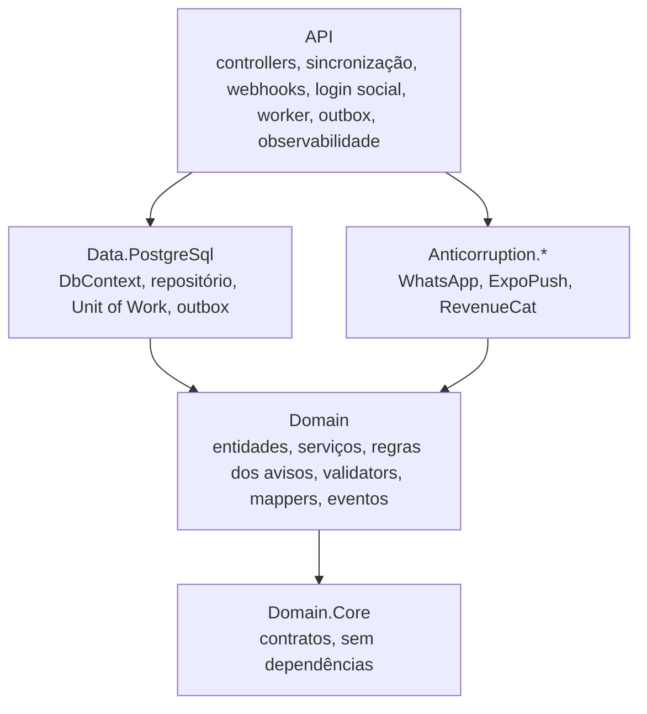

# Stack e arquitetura

Aplicativo para pessoas idosas organizarem os medicamentos e pedirem ajuda, com avisos a um familiar de confiança
pelo WhatsApp. O app roda só no celular da pessoa idosa, e o familiar não instala nada. O objetivo é custo baixo e
simplicidade para um desenvolvedor só. O que entra no MVP e as regras dos avisos estão em [escopo.md](escopo.md).

O back-end segue a mesma arquitetura do RevoSolutions.TVP, para reaproveitar código, convenções e o roteiro de
deploy.

## Visão geral

```
┌──────────── Celular da pessoa idosa ───────────────┐
│  Interface: Expo / React Native (TypeScript)       │
│        │                                           │
│  Motor de agenda (Expo)                            │
│   • Lembretes no horário                           │
│   • Ações Tomei e Lembrar depois com o app fechado │
│   • SQLite local como fonte da verdade             │
│   • Fila de saída e sinal de vida                  │
└───────────────┬───────────────────▲────────────────┘
                │ HTTPS             │ Push (ping)
┌───────────────▼───────────────────┴────────────────┐
│  API ASP.NET Core (.NET 10) + PostgreSQL           │
│   • Login Google/Apple e sincronização             │
│   • Eventos: dose, SOS, sinal de vida              │
│   • Worker a cada minuto: doses sem confirmação,   │
│     resumo das 20h, vigia de contato, abandono     │
│   • Outbox: envios ao WhatsApp                     │
│   • Webhook do WhatsApp: vínculo, PARAR, status    │
└───────────────┬────────────────────────────────────┘
                ▼
        WhatsApp Cloud API ──► Familiar
```

## Stack

| Camada | Escolha |
|---|---|
| Aplicativo | Expo (React Native) + TypeScript, compilado pelo EAS, sem o Expo Go; Android e iOS |
| Lembretes | `expo-notifications` (gatilhos diários repetidos e ações) e `expo-background-task` (fila de saída e sinal de vida) |
| Banco local | SQLite (`expo-sqlite`): o app funciona sem internet, e tudo é sincronizado com o servidor |
| Login no app | `@react-native-google-signin/google-signin` e `expo-apple-authentication` |
| Cliente da API | Gerado do OpenAPI pelo orval, como no `web/` do TVP |
| Assinaturas | RevenueCat (`react-native-purchases`): compra dentro do app pela Apple e pela Google; webhook para a API |
| Relatório em PDF | `expo-print` e `expo-sharing`, no próprio aparelho |
| Backend | .NET 10, ASP.NET Core Web API (C#); SDK fixado em `global.json` |
| Banco | PostgreSQL 17 |
| ORM | EF Core 10 + Npgsql |
| Autenticação | Login social (Google e Apple): a API valida o token do provedor e emite JWT com refresh token rotativo, como no TVP, sem ASP.NET Core Identity |
| Validação | FluentValidation |
| Mapeamento | Riok.Mapperly (gerado em compilação) |
| Eventos de domínio | Domain events + outbox, gravados na mesma transação |
| Agendamento | Um `BackgroundService` que roda a cada minuto e consulta o que venceu |
| Mensagens | WhatsApp Cloud API da Meta, direto, sem intermediário |
| Push | Serviço de push do Expo (gratuito), que entrega pelo FCM no Android e pelo APNs no iOS |
| Observabilidade | API: `Microsoft.Extensions.Logging` + OpenTelemetry (OTLP) e health checks, como no TVP. App: Sentry, plano gratuito |
| API | OpenAPI + Scalar, versionada com Asp.Versioning |
| Testes | xUnit, FluentAssertions, NSubstitute; Testcontainers nos testes que precisam do Postgres; Jest (`jest-expo`) no app |
| Build e deploy | Docker, Central Package Management, `dotnet format` no CI; app pelo EAS Build e EAS Submit; correções e conteúdo pelo ar com o EAS Update |

## Decisões-chave

- **Expo em vez de nativo.** Uma interface para Android e iOS. O EAS compila e envia às lojas a partir do Windows,
  sem Mac, e a parte em JavaScript pode ser corrigida pelo ar. Código nativo próprio, em Kotlin ou Swift, só entra
  se os testes em aparelhos reais mostrarem um ganho real.
- **O servidor decide a dose sem confirmação, nas duas plataformas.** O iOS não roda código em horário marcado. Com
  uma regra só, o app fica responsável apenas pelos lembretes, pelos registros e pela fila de saída.
- **O app funciona sem internet, e o servidor guarda uma cópia de tudo.** O lembrete e o registro dependem só do
  SQLite local. As mudanças sobem quando houver conexão, e é a cópia no servidor que permite trocar de celular e
  aproveitar os dados da base.
- **Login social obrigatório, sem senha.** Dá uma identidade estável à pessoa, que vale em qualquer celular, na
  assinatura e nos dados. Google no Android; Apple e Google no iPhone, porque a Apple exige o login dela quando o app
  oferece o do Google.
- **WhatsApp em vez de um app para o familiar.** A adesão é maior. O custo é por mensagem (ver
  [Custos do WhatsApp](escopo.md#custos-do-whatsapp)).
- **Compra dentro do app pelo RevenueCat.** As lojas exigem a cobrança delas quando o usuário paga por recursos do
  app. O RevenueCat atende as duas lojas com um SDK só e avisa a API por webhook.
- **PostgreSQL e .NET**, como no TVP: são gratuitos e a stack que o projeto já domina.

## Camadas

Monólito modular com núcleo DDD e uma camada anticorrupção por sistema externo, como no TVP. As dependências apontam
para o domínio. Não há multi-tenancy: cada pessoa idosa é identificada pela conta.



| Projeto | Responsabilidade |
|---|---|
| `Domain.Core` | Contratos: `IRepository`, `IUnitOfWork`, `IDomainEvent` e handler, exceções de domínio |
| `Domain` | Entidades (conta, perfil, medicamentos, registros, contato), serviços de domínio, as regras dos avisos (prazo, contato recente, teto diário, abandono), validators, mappers e eventos; os contratos dos sistemas externos (`Contracts/Messaging`, `Contracts/Push`, `Contracts/Billing`) |
| `Data.PostgreSql` | `CmiDbContext`, repositório genérico, Unit of Work, outbox e o interceptor que grava os eventos, refresh tokens |
| `Anticorruption.WhatsApp` | Cloud API da Meta: envio das mensagens de modelo e tradução do webhook (vínculo, PARAR, status de entrega) |
| `Anticorruption.ExpoPush` | Envio do ping ao aparelho e leitura dos recibos, que revelam a desinstalação do app |
| `Anticorruption.RevenueCat` | Tradução do webhook de assinaturas (compra, renovação, cancelamento, expiração) para o estado do Premium |
| `API` | Composição: endpoints do app e da sincronização, webhooks do WhatsApp e do RevenueCat, login social (validação dos tokens do Google e da Apple), worker, processador do outbox, telemetria |
| `mobile/` | Aplicativo Expo. Fica fora da solução .NET, como o `web/` do TVP |

## Avisos: eventos, worker e outbox

Diferente do TVP, aqui o outbox é o caminho principal: todo aviso ao familiar passa por ele.

1. **Eventos do app.** O app envia **Tomei**, SOS e sinal de vida. O serviço de domínio atualiza o estado e registra
   um `IDomainEvent`.
2. **Regras por tempo.** O worker roda a cada minuto e consulta o que venceu: doses sem confirmação depois de 1 hora,
   resumos das 20h no fuso da pessoa, lembretes de aniversário, aparelhos sem contato (com um ping antes do aviso) e
   pausas por abandono. Cada
   caso vira um evento de domínio.
3. **Outbox.** No `SaveChangesAsync`, o `DomainEventToOutboxInterceptor` grava os eventos na tabela
   `OutboxMessages`, na mesma transação.
4. **Envio.** O `OutboxProcessor`, hospedado na API, lê as linhas pendentes a cada poucos segundos, para o SOS chegar
   logo, e entrega cada uma aos handlers, que enviam pelo WhatsApp. A entrega é *at-least-once*. Por isso, cada aviso
   tem uma chave de idempotência (por exemplo, dose + tipo de aviso), para não pagar duas vezes pela mesma mensagem.
   Nenhuma mensagem pelo WhatsApp sai sem o Premium ativo.
5. **Status.** O webhook do WhatsApp grava o status de entrega, e o app o consulta para mostrar o status do SOS.

## Aplicativo

- **Expo com build próprio.** React Native com TypeScript, compilado pelo EAS, sem o Expo Go. A parte em JavaScript
  pode ser corrigida pelo ar, sem esperar a revisão das lojas.
- **Motor de agenda.** Um módulo em TypeScript expõe uma interface única (agendar, pausar e receber eventos de
  dose). Nas duas plataformas, ele começa só com bibliotecas do Expo:
  - `expo-notifications` agenda os lembretes com gatilhos diários repetidos e trata as ações **Tomei** e
    **Lembrar depois**.
  - `expo-background-task` cuida da fila de saída, com novas tentativas, e do sinal de vida. No Android, roda sobre o
    WorkManager. No iOS, roda quando o sistema permite.
  - Código nativo próprio só entra atrás da mesma interface se os testes em aparelhos reais mostrarem um ganho real.
    Um exemplo seria o **Tomei** não ser registrado com o app fechado.
- **SQLite local.** Medicamentos, horários, registros, contato e perfil ficam no aparelho, e o app funciona sem
  internet. Tudo é sincronizado com o servidor (ver [Sincronização](#sincronização)).
- **Login.** O app obtém o token do Google ou da Apple e o troca na API pelo JWT e pelo refresh token, guardados no
  armazenamento seguro do sistema.
- **Assinatura.** O SDK do RevenueCat usa o identificador da conta como usuário, então o Premium acompanha a conta em
  qualquer celular. **Restaurar compras** continua disponível. O app consulta o SDK para mostrar o que está liberado;
  o servidor confia só no webhook.
- **Relatório para a consulta.** O PDF é montado em HTML a partir do SQLite, gerado pelo `expo-print` e compartilhado
  pelo `expo-sharing`, sem depender de internet.
- **Conteúdo e textos.** Os artigos (um Markdown por artigo, com título, tema, condições de saúde e data), os
  telefones úteis (um JSON com categoria, nome, número e se é de emergência) e os textos da divulgação do Premium
  ficam em `mobile/content/` e vão junto com o app. Não há admin nem endpoint de conteúdo: o conteúdo novo é publicado
  por atualização pelo ar (EAS Update), sem revisão das lojas. Os textos ficam em
  português no próprio código, sem camada de i18n até haver um segundo idioma previsto.
- **SOS sem internet.** Se o envio pelo servidor falhar, o app oferece ligar e mandar SMS. O SMS abre o aplicativo de
  mensagens com o texto pronto, e por isso o app não precisa da permissão de SMS, que a Play restringe.

## Sincronização

O mais simples que atende um aparelho por conta, sem resolução de conflitos entre celulares.

- **Identificadores.** Cada registro (medicamento, horário, registro de dose, contato, perfil) nasce no aparelho com
  um UUID e uma data de alteração.
- **Envio.** Cada mudança entra na mesma fila de saída dos eventos e sobe em lotes quando houver conexão. O servidor
  grava pela data de alteração: a última alteração vence. Os registros de dose só são inseridos; a correção de um
  toque acidental é uma nova alteração do mesmo registro.
- **Celular novo.** No primeiro login num aparelho, o app baixa uma cópia completa da conta e preenche o SQLite.
- **Um aparelho ativo.** O login marca o aparelho como ativo. O anterior recebe uma recusa na próxima sincronização e
  mostra "Sua conta foi aberta em outro celular", com a opção de voltar a usá-lo ali, o que o torna o ativo de novo.
- **Avisos.** O servidor decide a dose sem confirmação a partir dos horários e dos registros sincronizados.

## Dados

- O servidor guarda a conta (provedor do login e e-mail), a data de nascimento, o perfil de saúde, os medicamentos
  com horários e dose, o histórico de registros, o contato de confiança (nome e WhatsApp) e os eventos.
- As condições de saúde são gravadas como códigos fixos (por exemplo, `hipertensao`, `diabetes`, `osteoporose`), mais
  o texto livre de "outra". Assim a lista pode crescer sem quebrar as análises.
- Revogar o acesso apaga do servidor os dados do familiar. Excluir a conta apaga tudo.
- A LGPD não guia as decisões do MVP por enquanto. As lojas continuam exigindo política de privacidade e a
  declaração dos dados coletados (rótulos de privacidade da Apple e seção "Segurança dos dados" da Play).

## Hospedagem

- O ponto de partida é o roteiro do TVP no Azure (Container Apps e PostgreSQL Flexible Server, região Brasil), com
  uma diferença: a API não pode dormir. O worker roda a cada minuto e o webhook do WhatsApp precisa responder, então
  a API fica com réplica mínima 1, o que sai da cota gratuita. Antes do lançamento, comparar o custo com um VPS
  pequeno com Docker Compose.
- Backup diário do banco.

## Pontos de atenção no Android

- **Alarme exato.** A partir do Android 14, a permissão `SCHEDULE_EXACT_ALARM` vem negada por padrão, e a Play
  reserva a `USE_EXACT_ALARM` a apps de despertador e calendário. A configuração inicial leva à tela de liberar a
  permissão.
- **Economia de bateria.** Xiaomi, Samsung e Motorola encerram apps em segundo plano. A configuração inicial orienta
  a remover a restrição, e os testes com os primeiros usuários incluem esses fabricantes.
- Código nativo próprio não resolve nenhum desses dois riscos. Só a configuração inicial e os testes em aparelhos
  reais resolvem.

## iOS

O iOS é desenvolvido em paralelo com o Android e publicado depois de testado (ver
[Lançamento](escopo.md#lançamento)). O motor de agenda segue a mesma regra nas duas plataformas. Sem iPhone para
depurar, uma biblioteca muito usada é menos arriscada que código Swift próprio.

- **Lembretes.** Notificações locais com gatilhos diários repetidos, que contornam o limite de 64 notificações
  agendadas e continuam tocando mesmo que o app fique semanas sem ser aberto. Notificações sensíveis ao tempo passam
  pelo modo Foco. Os alertas críticos, que tocam no silencioso, exigem aprovação da Apple e ficam fora.
- **Tomei com o app fechado.** O iOS acorda o app em segundo plano por alguns segundos para registrar e enviar.
- **Sem execução em horário marcado.** O iOS não roda código na marca de +1h nem em intervalos fixos. Foi por isso
  que a decisão de dose sem confirmação passou para o servidor, nas duas plataformas. No iOS, o aviso de celular sem
  contato usa 24 horas, e qualquer evento conta como sinal de vida.
- **Custo e ferramentas.** A conta Apple Developer custa US$ 99 por ano. O EAS compila o app e o envia ao TestFlight
  a partir do Windows, sem Mac. Testar notificações exige um iPhone real, e depurar Swift a fundo exige um Mac com
  Xcode.
