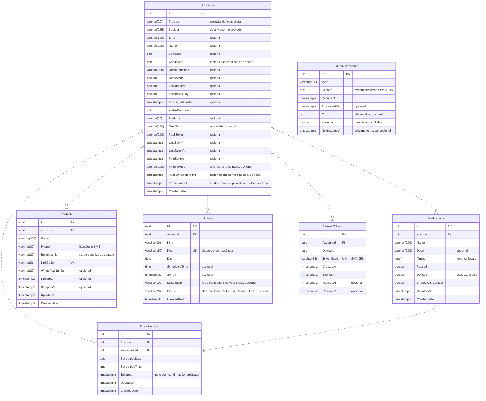

# Banco de dados

Diagrama entidade-relacionamento do PostgreSQL, baseado no `CmiDbContextModelSnapshot` após a migration
`AddOutboxRetries`. Atualize o diagrama quando uma migration alterar tabelas, colunas ou chaves.

## Notas

- O par `(Provider, Subject)` é único em `Accounts`. O perfil e os dados do aparelho ativo ficam na própria
  conta.
- As chaves estrangeiras usam `ON DELETE CASCADE`. Na sincronização, a exclusão lógica de medicamentos
  (`Deleted = true`) preserva o histórico de doses.
- O índice de `Contacts.AccountId` permite vários registros por conta. O vínculo usa `LinkCode` e os avisos
  seguem para `WhatsAppNumber` após a confirmação pelo contato.
- O índice de `Notices.MessageId` permite localizar o aviso quando o webhook do WhatsApp informa o status da
  entrega.
- `OutboxMessages` guarda os eventos de domínio na mesma transação da alteração que os gerou e fica sem chave
  estrangeira. O processador usa `Attempts` e `NextAttemptAt` para limitar e agendar as novas tentativas.
