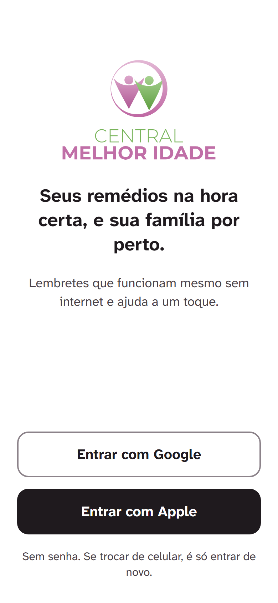
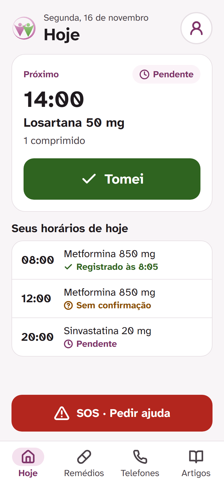
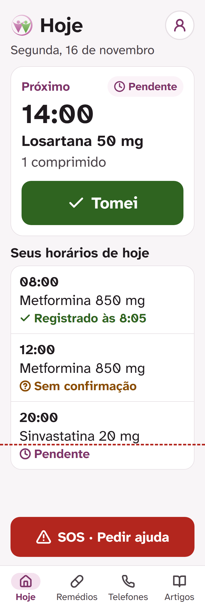
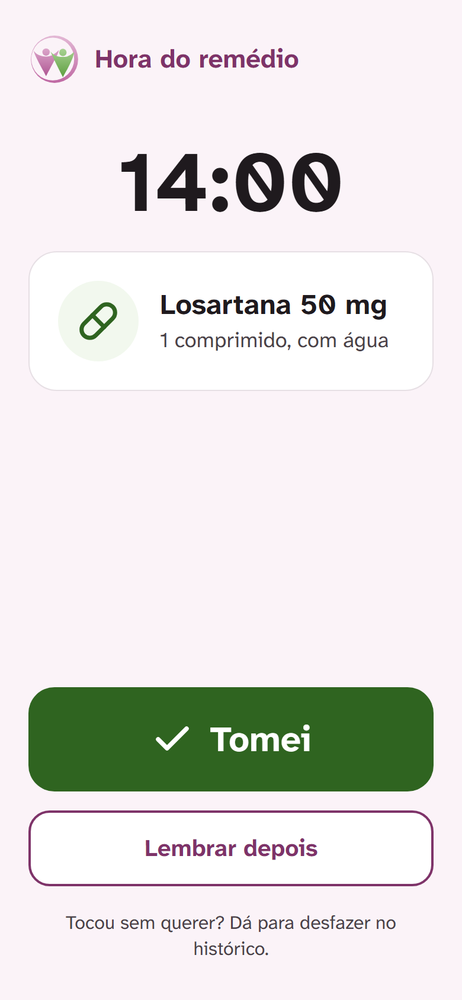
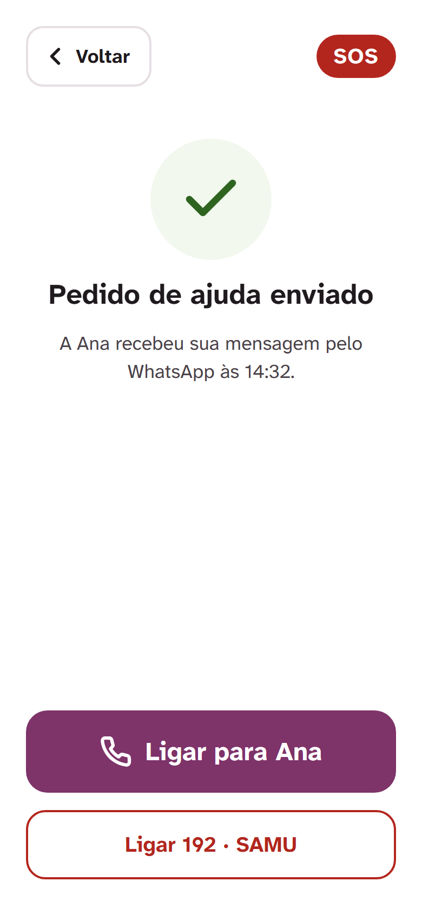
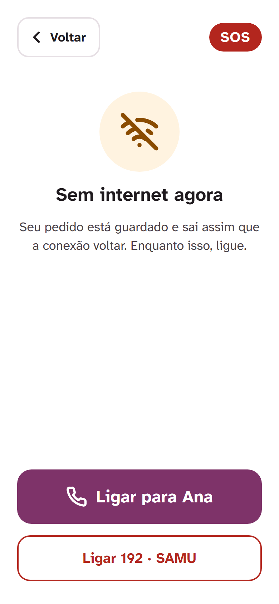
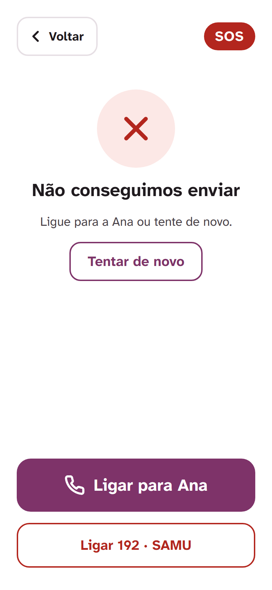

# Marca da Central Melhor Idade

O logo vetorizado, a paleta e as regras de texto do app. No código, cores e tamanhos vêm de `mobile/src/theme.ts`; mude
aqui e lá juntos. As telas de exemplo estão no [canvas de identidade](https://claude.ai/artifact/KkgXf3Cyrsv7azcrM7StK1).

## Logo

| Arquivo | Uso |
| --- | --- |
| `cmi-logo.svg` | Padrão, horizontal, em fundo claro |
| `cmi-logo-vertical.svg` | Telas de entrada e espaços estreitos |
| `cmi-simbolo.svg` | Cabeçalho do app e espaços pequenos |
| `cmi-logo-branco.svg`, `cmi-simbolo-branco.svg` | Sobre Orquídea 800 ou fotos escuras |
| `cmi-icone-app.svg` | Fonte dos ícones em `mobile/assets` (1024 px, fundo branco) |
| `cmi-logo-original.png` | Referência do logo antes da vetorização |

- O texto do logo é Montserrat (Light em “CENTRAL”, Bold em “MELHOR IDADE”) convertida em curvas. A fonte só aparece no
  logo.
- Deixe em volta um respiro da altura de uma cabeça do símbolo.
- Tamanho mínimo: logo horizontal com 140 px de largura e símbolo com 32 px.
- Não estique, não gire, não troque as cores nem aplique sombra. Não coloque o logo colorido sobre fundo escuro.

## Cores

Contraste medido sobre branco. Abaixo de 4,5:1 a cor não serve para texto.

| Cor | Hex | Contraste | Uso |
| --- | --- | --- | --- |
| Orquídea 50 | `#FBF3F8` | | Fundo de Pendente e de avisos |
| Orquídea 100 | `#F4E1EE` | | Marca da aba ativa |
| Orquídea 200 | `#E8C3DC` | | Bordas |
| Orquídea 500 | `#C06FA7` | 3,5:1 | Só no logo, nunca em texto |
| Orquídea 700 | `#9C4A85` | 5,6:1 | Links |
| Orquídea 800 | `#7E3369` | 8,2:1 | Botão principal, títulos, notificação |
| Orquídea 900 | `#4E1F41` | 13:1 | Botão pressionado |
| Folha 50 | `#F2F8EE` | | Fundo de Registrado |
| Folha 200 | `#CDE5C0` | | Bordas |
| Folha 500 | `#78B45A` | 2,5:1 | Só no logo, nunca em texto |
| Folha 700 | `#3F7A2A` | 5,2:1 | Ícones |
| Folha 800 | `#2F6420` | 7,1:1 | Botão Tomei, texto de Registrado |
| Folha 900 | `#1E4214` | 11:1 | Botão Tomei pressionado |
| Tinta | `#1F1A1E` | | Texto principal |
| Grafite | `#4A4248` | | Texto de apoio |
| Contorno | `#8C838A` | 3,7:1 | Borda de campos |
| Divisória | `#E6DFE4` | | Linhas e bordas de cartões |
| Superfície | `#F8F5F7` | | Fundo das telas |

Estados da dose e o SOS sempre levam ícone e palavra, nunca só a cor:

| Estado | Texto | Fundo |
| --- | --- | --- |
| Registrado | Folha 800 `#2F6420` | Folha 50 `#F2F8EE` |
| Pendente | Orquídea 800 `#7E3369` | Orquídea 50 `#FBF3F8` |
| Sem confirmação | Âmbar `#8A4B00` | `#FFF3E0` |
| SOS | Branco | Vermelho `#B3261E` (fundo de erro `#FCE8E6`) |

## Texto

A fonte da interface é Atkinson Hyperlegible Next (400 e 700), do Braille Institute, feita para quem enxerga pouco. O
app a carrega de `@expo-google-fonts/atkinson-hyperlegible-next`.

| Papel | Tamanho / altura da linha |
| --- | --- |
| Tela | 26 / 32, negrito |
| Título | 20 / 26, negrito |
| Botão | 18 / 24, negrito |
| Corpo | 17 / 24 |
| Apoio | 16 / 22 |

- Os tamanhos valem com a fonte padrão do celular. Tudo cresce com o ajuste do sistema, e nada fica abaixo de 16.
- Tamanho grande de verdade só onde há ação: no lembrete, o horário (72) e o Tomei (30), além do SOS.
- Rótulos das abas crescem até 1,15×, chips até 1,3×, títulos até 1,7× e o título da tela até 1,5×
  (`maxFontSizeMultiplier`), para não quebrarem em várias linhas com a fonte do sistema grande; o corpo e o apoio
  acompanham o sistema sem limite.
- O modo de letras grandes do app multiplica tudo por 1,25× só enquanto a fonte do sistema estiver abaixo de 130%:
  quem já aumentou a fonte do celular não recebe as duas escalas somadas, e o modo vira "Mais contraste". Ele sempre
  reforça o contraste: o texto de apoio passa de Grafite para Tinta, e as bordas de cartões e divisórias passam de
  Divisória para Contorno, com 2 dp. A paleta já passa de 4,5:1 nos textos, então o modo não troca nenhuma outra cor.
- Com a fonte acima de 130% (`fontScale` de `useWindowDimensions`), o que fica lado a lado passa a ficar empilhado. A
  tela rola só na vertical, nunca na horizontal.
- Teste com a maior fonte do sistema. No Android 14 ou mais novo a ampliação não é linear: textos grandes crescem
  menos que os pequenos.

## Toque e ícones

- Área de toque mínima de 56 dp, 64 dp ou mais nas ações principais e 16 dp entre botões.
- Ícones Lucide (`lucide-react-native`) com traço 2,5 e 28 dp, sempre ao lado de uma palavra.

## Telas de exemplo

Referência visual exportada do canvas em `telas/`, a 2× de um celular de 390 × 844 pt. Não são as telas do app; apague
cada imagem quando a tela de verdade existir.

| Entrada | Hoje | Hoje com a fonte em 150% |
| --- | --- | --- |
|  |  |  |

Na tela com a fonte em 150%, a linha tracejada marca o fim da tela; o resto aparece rolando, só na vertical.

| Hora do remédio | SOS enviado | SOS sem internet | SOS com falha |
| --- | --- | --- | --- |
|  |  |  |  |

## Voz

Frases curtas, tratando a pessoa por “você”. Os avisos dizem o que aconteceu e nunca culpam: “não recebemos a
confirmação”, não “você não tomou”. Sem promessas clínicas.
